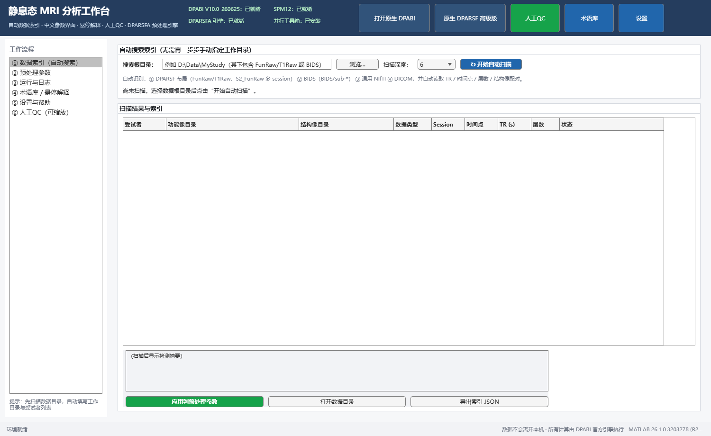
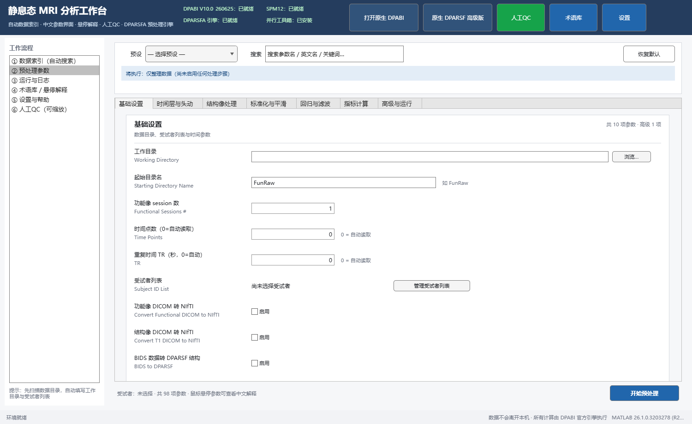
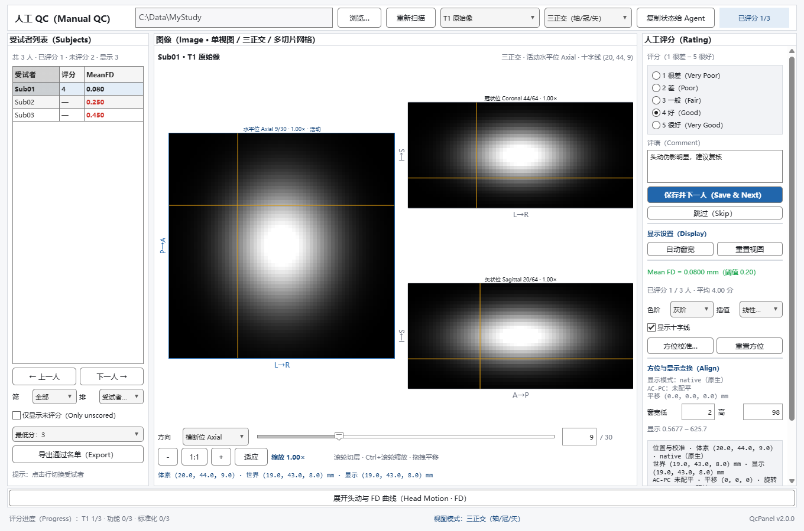

# dsh-mri-workbench

[](https://github.com/Ezerruier/dsh-mri-workbench/actions/workflows/ci.yml)
[](LICENSE)
[](#前置条件)
[](#前置条件)
[](#前置条件)

**在 DeepSeek Harness 里运行的 MRI 静息态分析工作台（DPABI / DPARSF 后端）**

把 MATLAB 侧的静息态 fMRI 工作台接进 DeepSeek Harness：数据集扫描/索引、DPARSF 预处理
配置与运行前校验、独立 MATLAB 进程后台运行官方 `DPARSFA_run`、可选的人工 QC 与头动结果
解读，都能在 Harness 会话里完成；也可以让 Agent 直接调用同一套 `mri_workbench_*` 工具。

| 数据索引（自动扫描 / 识别布局） | 预处理参数（98 字段 · 中英文 · 悬停解释） |
| --- | --- |
|  |  |



> 截图来自 MATLAB 工作台自测脚本渲染的示例界面，使用合成测试数据，不含真实被试数据。

## 仓库包含两部分

| 部分 | 位置 | 说明 |
| --- | --- | --- |
| **DSH 插件** | 仓库根目录（`index.mjs` / `client.js` / `package.json`） | 在 Harness Web UI 中提供「MRI 工作台」页面、`/mri` 命令与 `mri_workbench_*` Agent 工具；只做编排，计算全部在 MATLAB 进程完成 |
| **MATLAB 工作台** | [`matlab/MRI_Workbench/`](matlab/MRI_Workbench/README.md) | 可独立运行的 MATLAB GUI（`StartWorkbench`）：数据索引、预处理参数面板、后台运行、术语库、人工 QC 查看器；插件通过 `mrw.*` 调用它 |

## 仓库结构

```text
dsh-mri-workbench/
  index.mjs / client.js        DSH 插件 Host / Client 半侧（仓库根目录即插件包）
  package.json / cordis.patch.yml / locale/ / icon.svg
  docs/
    VERIFICATION.md            插件验证记录（安装、工具实测、UI 与人工 QC 链路）
    screenshots/               README 截图
  matlab/MRI_Workbench/        MATLAB 工作台（独立可用）
    StartWorkbench.m           启动入口
    +mrw/                      工作台代码（MATLAB package）
    docs/                      使用手册、DPABI 引擎研究、QC 契约、DSH 集成说明
    resources/                 术语库 / 原生界面中文标签
    tests/                     MATLAB 自测脚本
  tests/node/                  离线 Node 自测（不启动 DSH / MATLAB）
```

## 快速开始

### 方式 A：作为 DSH 插件使用（推荐）

1. 获取仓库（`git clone` 或下载 ZIP）：

   ```bash
   git clone https://github.com/Ezerruier/dsh-mri-workbench.git
   ```

2. 把 MATLAB 工作台放到 **当前 DSH 会话工作区的根目录**：插件默认查找
   `<workspace>/MRI_Workbench/`。

   - Windows 可复制该目录，或用目录联接：`mklink /J <workspace>\MRI_Workbench <仓库>\matlab\MRI_Workbench`；
   - 也可以不复制，改为设置环境变量 `MRI_WORKBENCH_ROOT=<仓库>\matlab\MRI_Workbench`。

3. 安装插件 bundle：`plugin_manager install_bundle  target = <仓库根目录绝对路径>`。

安装后：
- Agent 工具表出现 `mri_workbench_env` / `mri_workbench_scan` / `mri_workbench_prepare` / `mri_workbench_start` / `mri_workbench_status` / `mri_workbench_wait` / `mri_workbench_cancel` / `mri_workbench_open_gui` / `mri_workbench_qc` / `mri_workbench_qcstate` / `mri_workbench_results` / `mri_workbench_censor` / `mri_workbench_params` / `mri_workbench_overrides`；
- 刷新页面后，会话视图多出「MRI 工作台」标签页（含 ①②③④⑤ 五张卡片，④ 为人工 QC（含「读取 MATLAB QC 状态」按钮），⑤ 为头动结果解读与可视化）；
- 新建会话的开始界面，在工作区/模式选择旁点击 **打开 MRI 工作台** 即可直接进入；左上角 **返回开始** 可回到原来的空白会话，无需先发送消息；
- 命令 `/mri ...` 可用（`/mri help` 查看）。

补充：插件是 workspace bundle，运行数据写在当前会话工作区的 `.mri-workbench/`（扫描索引、
配置、运行日志），不会修改 DPABI 安装目录与用户研究数据（DPARSF 预处理输出除外）。

### 方式 B：只使用 MATLAB 工作台

```matlab
cd('<仓库>\matlab\MRI_Workbench')
StartWorkbench
```

不装 DSH 插件也能单独使用数据索引、参数面板、后台预处理与人工 QC；详见
[MATLAB 工作台 README](matlab/MRI_Workbench/README.md) 与
[使用手册](matlab/MRI_Workbench/docs/使用手册.md)。

### 前置条件

- Windows 10/11；
- DeepSeek Harness Desktop（`dsh` 0.2.x profile）；
- MATLAB（默认自动探测 `D:\Program Files\Matlab\MatlabRxxxx\bin\matlab.exe`，可用环境变量 `MATLAB_EXE` 指定）；
- DPABI（默认 `D:\Software\DPABI`，可用 `DPABI_ROOT` 指定）与 SPM12（默认 `D:\Software\spm12`，可用 `SPM_ROOT` 指定）；MATLAB 的已保存路径中应包含它们；
- MRI 工作台目录：默认 `<当前会话工作区>/MRI_Workbench/`，可用环境变量 `MRI_WORKBENCH_ROOT` 指定。

## 文档

- [MATLAB 工作台 README](matlab/MRI_Workbench/README.md)：安装、数据目录规范、六个页面、运行环境
- [使用手册](matlab/MRI_Workbench/docs/使用手册.md)：数据准备、参数含义、预设、运行与排错
- [人工 QC 使用说明](matlab/MRI_Workbench/docs/人工QC使用说明.md)：可缩放查看、DPARSF 兼容评分、阈值与名单
- [DSH 集成说明](matlab/MRI_Workbench/docs/DSH集成说明.md)：插件页面、Agent 工具、后台 Job
- [插件验证记录](docs/VERIFICATION.md)：真实安装/工具调用/UI 与人工 QC 链路验证（含脱敏说明）
- [DPABI 引擎研究](matlab/MRI_Workbench/docs/DPARSFA_ENGINE.md)：DPARSFA 源码行为、Cfg 全字段、日志与校验
- [QC UI v2 设计契约](docs/QC_UI_V2_CONTRACT.md)：人工 QC 查看器的接口/布局/状态文件 schema
- [QC 契约](matlab/MRI_Workbench/docs/QC_CONTRACT.md) · [原生界面汉化](matlab/MRI_Workbench/docs/NATIVE_PATCH.md) · [术语库来源](matlab/MRI_Workbench/docs/GLOSSARY_SOURCES.md)

## 功能特性

- 在 Harness Web UI 的会话视图里新增 **「MRI 工作台」** 页面：数据扫描（① 卡的数据根目录既可手动输入/粘贴，也可点 **浏览…** 弹出系统文件夹选择框）、预处理配置校验、启动/取消 DPARSF、状态刷新；
- **Agent 工具** `mri_workbench_*`：让 Agent 直接扫描数据、生成配置、启动后台预处理、等待并汇报进度；
- **人工 QC**：`mri_workbench_qc` 直接读取 DPARSF 兼容的评分 TSV 汇总各模态进度/低分/MeanFD 超阈值；`/mri qc` 打开 MATLAB 可缩放人工 QC 查看器（1–5 分，与 DPARSF 完全兼容）；`mri_workbench_qcstate` / `/mri qcstate`（页面 ④「读取 MATLAB QC 状态」）读取人工 QC 窗口写出的实时状态（三正交/十字线体素与世界 mm/原点与 AC-PC 配平/显示矩阵/窗宽/叠加/FD 类型与坏帧/评分进度），与 `matlab_snapshot` 截图配合做「Agent 实时指导」；
- **结果解读与可视化**：`mri_workbench_results`（页面 ⑤ 卡）纯 Node 读取 `RealignParameter/HeadMotion.tsv` 与逐帧 FD 文件，生成每名受试者的头动指标表 + FD 曲线图，并逐列解释含义、给出按阈值的启发式提示与**最大平移/旋转、坏帧比例的经验分级参考**；不启动 MATLAB；
- **Scrubbing / Censor**：`mri_workbench_censor` 与 `/mri censor` 按逐帧 FD 阈值（FD_Jenkinson/FD_Power，可加前后邻帧扩展）计算每名受试者的坏帧帧号，可导出到 `ScrubbingPreview/`，并解释 DPABI 的 `IsScrubbing` 与 `Covremove.IsHeadMotionScrubbingRegressors` 两种做法；页面 ⑤ 卡可直接预览坏帧（可选前/后扩展帧数）并写入参数覆盖（可选取/插值方式，或 **spike 回归量**方式）；
- **实时反馈**：预处理以 DSH **后台 Job** 运行，日志实时流式显示在会话顶部「后台任务」列表，Agent 也可用 `job_output` / `mri_workbench_wait` 获取；
- **计算仍在 MATLAB 侧**：插件只做编排，预处理由独立 MATLAB 进程调用官方 `DPARSFA_run`（DPARSF 高级版引擎）完成；人工 QC 摘要则在 Node 内只读解析，不启动 MATLAB。

## 使用

### 在 Harness UI 中

1. 「MRI 工作台」页 → 输入数据根目录（其下为 `FunRaw/<受试者>/` 或 `BIDS/`；也可点 **浏览…** 弹出系统文件夹选择框，选中的绝对路径会自动填入）→ **开始扫描**（扫描输出会列出受试者，并解释工作目录里各处理阶段目录的数据经过哪些步骤，见下文「扫描输出：目录处理历史」）；
2. 选择预设；需要手动调参时点 **参数设置…（弹窗）** 打开 DPARSF 风格参数面板（分组导航、中英文对照、悬停解释、依赖联动），点 **应用覆盖** 后回到卡片；② 卡上还可直接下拉选择 **并行 worker 数（被试并行）**（0=串行 / 2/4/6/8/12，选择后自动合并进参数覆盖）；然后 **生成配置并校验**（显示运行前检查结果，并列出已应用的覆盖项）。预设有 5 个，其中预设 5「空白（仅补步骤/续跑）」默认关闭全部步骤，用于在已有中间结果上补做一步；预检未通过（如检测到已处理目录上重复删点、rp 文件冲突）时「开始预处理」会被阻止；
3. **开始预处理** → 实时日志在会话顶部「后台任务」；可 **刷新状态** / **取消运行**；
4. 需要 MATLAB 原生界面（完整中文参数悬停、术语库、手动调参）时点 **打开 MATLAB 桌面版**——页面右上角有常驻的「打开 MATLAB 桌面版」按钮（③ 运行卡里也有同一入口）；
5. 头动校正完成后看 **⑤ 头动结果解读与可视化**：自动/手动读取 `RealignParameter/HeadMotion.tsv` 与逐帧 FD 文件，表格列出每人 mean FD、最大平移/旋转、坏点帧数占比（**最大平移/旋转/坏帧比例带经验分级参考与配色**），下方画逐帧 FD 曲线并逐列解释含义。曲线支持 **多受试者叠加**：默认全选，可勾选/取消受试者、点表格行切换，也可切换曲线指标（FD_Jenkinson / FD_Power）与参考阈值（0.2/0.5/1.0 mm）。同一张卡还提供 **坏帧 / Scrubbing（censor）预览**：选择 FD 类型、每帧阈值与 **向前/向后扩展帧数**（对应 DPABI `Scrubbing.PreviousPoints/LaterPoints`）即可看到每人坏帧帧号；「Scrubbing 方式」里的 cut/nearest/linear/spline/pchip 走 `IsScrubbing`（删点/插值），选 **spike** 则改用 **头动 scrubbing 回归量**（`Covremove.IsHeadMotionScrubbingRegressors`，每个坏帧一个回归量、不缩短序列，又称 spike regression），两种方式互斥；可 **导出坏帧清单**（`ScrubbingPreview/`）或 **写入参数覆盖**（含前/后扩展帧数）。命令行等价：`/mri results [工作目录]`、`/mri censor [jenkinson|power] [阈值] [prev=N] [later=N]`，Agent 用 `mri_workbench_results` / `mri_workbench_censor`；
6. 预处理完成后在 **④ 人工 QC** 卡片里 **打开 MATLAB 人工 QC** 逐被试看图评分（1–5 分 + 评语），评分保存在工作目录 `QC/*.tsv`；随时点 **刷新 QC 评分** 查看汇总。MATLAB 人工 QC 窗口 v2 支持三正交联动/十字线坐标/原点与 AC-PC 配平/方位校准/多切片网格/FD 曲线联动/排序筛选，并会在操作后写 `QC/.qcviewer_state.json`；点 ④ 卡 **读取 MATLAB QC 状态**（`/mri qcstate`）即可看当前十字线、AC-PC、显示矩阵、窗宽、叠加、FD 与评分进度。对话里问「MATLAB 人工 QC 现在显示什么、怎么校准」时，Agent 会先 `matlab_snapshot` 截图，再用 `mri_workbench_qcstate` 读精确状态给实时指导。

#### 数据根目录：手动输入或「浏览…」选择

① 数据索引卡的数据根目录支持两种填法：直接输入/粘贴路径，或点 **浏览…** 弹出系统文件夹选择框：

- **桌面版 Harness**：弹出操作系统原生「选择文件夹」对话框（Electron preload 暴露的目录选择桥），选中后把绝对路径写入「数据根目录」输入框；
- **普通 Web 访问**（浏览器与 Host 在同一台机器）：自动回退到 `ui-workspace` 服务的 Host 侧原生目录选择器，同样返回绝对路径；
- 用户取消对话框不会改动输入框；当前界面没有任何可用目录选择器时给出中文提示，仍可手动输入；
- 「浏览…」只负责选目录，不会自动开始扫描——选好后仍需点 **开始扫描**。

#### 执行输出（错误红色显示）

页面底部的「执行输出」卡片按行着色：以 `错误：`（或 `Error:`）开头的小节及其列表项、以及包含「检查未通过 / 发现 N 个错误（N>0）/ 已阻止启动 / 取消失败 / 生成配置失败 / 参数覆盖无效」等失败提示的行显示为 **红色**（主题错误色），其余输出保持默认色；`提醒：/警告：/Warning:` 小节恢复默认色。输出文字本身不做改动（复制内容与命令返回一致）。

### 对 Agent

典型对话：

> 扫描 `D:\Data\MyStudy`，用快速质控预设生成配置，检查通过后启动预处理，并每 30 秒汇报进度。

Agent 会依次调用：
`mri_workbench_env` → `mri_workbench_scan` → `mri_workbench_prepare` → `mri_workbench_start` → `mri_workbench_wait`（循环）→ 汇报。

人工 QC 典型对话：

> 预处理做完了，帮我汇总 T1/功能像/标准化的人工 QC 评分，哪些被试分数低？

Agent 调用 `mri_workbench_qc`（可传 `workDir`，缺省用最近一次配置的工作目录）得到各模态已评分/总数/平均分、低分（≤2）与未评分名单、MeanFD 超阈值名单和最近评语，再提示低分被试复核；需要人工看图时让用户在页面点 **打开 MATLAB 人工 QC** 或执行 `/mri qc`。

人工 QC 实时指导典型对话：

> MATLAB 人工 QC 窗口现在显示的是哪个受试者？三正交对齐吗？十字线在哪、AC-PC 距离多少？下一步怎么微调？

Agent 先 `matlab_snapshot` 抓真实截图（判断显示是否正常），再调用 `mri_workbench_qcstate`（工具参数 `workDir?`，不启动 MATLAB）读取 `QC/.qcviewer_state.json`：受试者/模态、视图模式与活动方向、十字线体素与世界 mm、显示模式（native/原点/AC-PC）、AC-PC 距离与角度、手动平移/旋转/翻转、显示矩阵、窗宽色阶、叠加、FD 类型与坏帧、评分进度与更新时间——据此给实时指导；不得凭空描述状态。状态文件缺失/损坏/>30 分钟未更新时工具返回中文提示，Agent 会请用户先在窗口操作一次或点「复制状态给 Agent」。

手动调参典型对话：

> 把快速质控预设的 TR 改成 2.5，并保留前 10 个时间点（不做删除），再重新生成配置看看检查结果。

Agent 会先 `mri_workbench_params`（或 `filter` 搜索字段）确认 key，再 `mri_workbench_overrides` 保存 `TR=2.5`、`IsRemoveFirstTimePoints=false`，然后 `mri_workbench_prepare`（自动合并覆盖）并汇报校验结果与将执行的步骤变化。

### 命令

```
/mri env
/mri presets
/mri scan "D:\Data\MyStudy" 6
/mri params [关键词]                    # 列出可调 Cfg 参数（首次启动一次 MATLAB 读 CfgSchema）
/mri overrides                         # 查看已保存的参数覆盖
/mri overrides set <base64(JSON数组)>  # 应用参数覆盖
/mri overrides clear                   # 清空参数覆盖
/mri prepare 4
/mri prepare 4 TR=2 IsRemoveFirstTimePoints=true   # 一次性覆盖（与已保存覆盖合并）
/mri prepare 5 StartingDirName=FunImgAR IsScrubbing=true   # 空白/续跑预设：从 FunImgAR 补 scrubbing
/mri run
/mri status
/mri cancel
/mri open
/mri qc ["D:\Data\MyStudy"]
/mri qcstatus ["D:\Data\MyStudy"]
/mri qcstate ["D:\Data\MyStudy"]                    # 读取 MATLAB 人工 QC 窗口实时状态（十字线/AC-PC/显示矩阵/窗宽/叠加/FD/评分；不启动 MATLAB）
/mri results ["D:\Data\MyStudy"]                    # 头动表格 + FD 曲线 + 逐列解释（不启动 MATLAB）
/mri censor jenkinson 0.2 ["D:\Data\MyStudy"]       # 生成并导出坏帧（scrubbing）清单到 ScrubbingPreview/
/mri censor jenkinson 0.2 prev=1 later=1 ["D:\Data\MyStudy"]   # 邻域扩展：把坏帧前 1 / 后 1 帧一并标记
```

### 运行前预检：已处理目录 / rp 冲突 / 续跑（预设 5）

`生成配置并校验`（`/mri prepare`）在原有检查之外会做"二次处理预检"，并把结果显示在输出里：

| 检测场景 | 结果 |
|---|---|
| 工作目录已有处理阶段目录（`FunImgA`/`FunImgAR`/`FunImgARB` 等或 `RealignParameter`），且从 `FunImg` 重新执行「删除初始时间点」 | **error**：会再次原地裁剪数据，禁止启动 |
| 已有处理阶段目录，但仍从 `FunImg` 重新执行其它步骤 | **warn**：可能重复处理并与旧文件混用，建议改用续跑 |
| `RealignParameter/<受试者>/` 有多个 `rp*.txt` 且配置会重跑头动校正 | **error**：FD 计算会因 rp 文件个数>1 报「输入参数太多」，禁止启动 |
| 续跑模式（`StartingDirName` 已是 `FunImgAR` 等阶段目录）且只开后续步骤 | **ok**：列出将执行步骤，并检查所需 FD 文件 |
| 续跑模式但缺少 `RealignParameter/<受试者>/FD_Jenkinson_<受试者>.txt` 等 FD 文件 | **error**：Scrubbing 等步骤会失败 |
| 空白预设（无任何启用的步骤） | **warn** 并阻止启动：需先勾选要补做的步骤 |

- 预检有 error 时 `开始预处理` / `mri_workbench_start` 会被拒绝，并返回第一条 error 作为原因；修正并重新 `生成配置并校验` 后才能启动。
- 续跑步骤：预设选 **空白（仅补步骤/续跑）** → 参数设置弹窗「基础设置 → 起始目录名」填 `FunImgAR`（上一次最后一步的头动校正输出）→ 勾选要补的步骤（如 `IsScrubbing` + `Scrubbing.*`；页面 ⑤ 的「写入 scrubbing 参数覆盖」也可直接写）→ 生成配置并校验。
- 若要从原始数据完整重跑：先把原始数据恢复到干净的工作目录（删除/移走 `FunImgA*`、`RealignParameter` 等中间产物，并把被裁剪的 `FunImg` 换成原始帧数），否则「删除初始时间点」会在已裁剪数据上再删一次。

### 扫描输出：目录处理历史（FunImg* 后缀含义）

「开始扫描」/`/mri scan` 的执行输出除了受试者列表，还会解释工作目录里**每个功能像阶段目录的数据经过哪些处理**（只读目录结构，不启动 MATLAB）：

- `FunImg`：功能像 NIfTI 起始数据；若跑过「删除初始时间点」，此目录会被**原地裁剪**（帧数已不是原始值）；
- `FunImgA`：时间层校正后（`A` = Slice Timing）；
- `FunImgAR`：在上一步基础上做了头动校正（`R` = Realign）；
- `FunImgARB`：再做了 Scrubbing（`B` = scrubbing；输出文件为 `<受试者>/<受试者>_4DVolume.nii`）；
- 其它后缀：`C` 协变量回归、`W` 标准化、`S` 平滑、`F` 滤波、`D` 去线性趋势、`sym` VMHC 对称化（字母按实际运行顺序追加）；
- 同时列出 `RealignParameter`（rp/mean/FD/HeadMotion 等）、`Results`、`VoxelSpecificHeadMotion`、`T1Img` 等目录各自的用途；
- 检测到多个阶段目录时会给出**续跑提示**：只想补做某一步时，把参数「起始目录名」（`StartingDirName`）设为相应阶段目录并关闭之前的步骤——例：只补 Scrubbing 时设 `StartingDirName=FunImgAR`（不是 `FunImg`），并关闭删初始点/层校正/头动校正；完整重跑前先恢复原始数据，避免重复删点和 rp 文件重名。
- **扫描根目录本身也可以是某个功能像/阶段目录**（例如直接扫描 `<工作目录>\FunImgARB` 查看中间结果或准备续跑）：工作台按「续跑模式」解释——`WorkingDir` 自动取其上级目录、`StartingDirName` 取该目录名（如 `FunImgARB`），受试者取该目录下含图像文件的子目录，并从各受试者的 4D NIfTI 头读取 TR/时间点/层数（不再显示「未知」）；结构像自动在上级目录的 `T1Raw`/`T1Img`/`AnatRaw/<受试者>` 查找。

命令行等价：`/mri scan <目录>`；Agent 工具 `mri_workbench_scan` 的返回文本同样包含该说明（结构化字段为 `processingHistory`）。

### 手动调整预处理参数（DPARSF 风格参数弹窗）

页面「② 预处理配置」不再只能选预设，也不再要求手写 JSON：

- **打开弹窗**：点 **参数设置…（弹窗）**，弹出 DPARSF 风格参数面板（内嵌弹窗，可 Esc/点遮罩关闭）。
- **分组导航**：左侧按 7 个 DPARSF 分组切换（基础设置 / 时间层与头动 / 结构像处理 / 标准化与平滑 / 回归与滤波 / 指标计算 / 高级与运行）。
- **中英文对照**：每个字段显示中文标签 + English 原名 + Cfg key；顶部标题、分组名同样中英对照。
- **鼠标悬停解释**：悬停在字段上显示 tooltip——中文解释（来自工作台 `resources/glossary.tsv` 的 Tip）、类型、默认值、启用条件、是否高级参数。
- **控件按类型自适应**：bool→开关；enum→下拉（选项带中文标签）；int/double→数字输入；vector→`[4, 4, 4]` 文本；text/dir/file→文本框；受试者列表只读。
- **依赖联动**：不满足启用条件（如未开时间层校正时的层数/层序）自动置灰并提示由哪个参数控制；DPARSF「0=自动」的字段在默认值处可看到说明。
- **搜索与高级参数**：顶部搜索框可按中文/英文/key 跨分组过滤；勾选「显示高级参数」展开高级项。
- **应用/恢复**：底部显示「已修改 N 项 / 当前覆盖 M 项」；**应用覆盖** 保存到会话（下次生成配置自动合并），**恢复默认** 重置表单，**清空全部覆盖** 清除所有手动覆盖。
- **高级 JSON 兜底**：卡片上的「高级（JSON 覆盖）」保留原 JSON 编辑器，与弹窗共用同一套覆盖状态。
- **Agent 等价能力**：`mri_workbench_params`（查看字段，含 `tip` 悬停解释）、`mri_workbench_overrides`（show/set/clear）、`mri_workbench_prepare({overrides:[{key,value}]})`；页面弹窗通过 `/mri paramsjson` 取字段、`/mri overrides set` 保存，与工具共享 Host 逻辑。
- **MATLAB 桌面版**仍是完整参数面板（`② 预处理参数`，98 个字段带中文悬停解释），与弹窗同一套 CfgSchema 字段。

**并行加速（可选）**：`ParallelWorkersNumber`（「高级与运行」组，需先勾选「显示高级参数」）控制同时处理的被试数，`0`=串行。工作台会在启动前按 `min(设定值, 物理核心数, 被试数)` 显式建并行池（建池失败自动回退串行并写日志）。本机 24GB 内存建议：快速质控 6–8、仅功能像 4–6、经典 DARTEL 全流程 3–4。也可用 `/mri prepare <预设> ParallelWorkersNumber=4` 或 `mri_workbench_overrides` 设置。

**T1 裁剪兼容（可选）**：若 `T1Img` 里只有 NIfTI 的 `T1.nii`（没有 DICOM），DPARSF 的 T1 裁剪走 dcm2niix 会生成不出 `c*/co*`。页面 ② 卡新增「T1 裁剪兼容模式」下拉（参数覆盖 `T1CropCompat`，默认 `auto`）：`old_dcm2nii` 在运行前用 DPABI 自带的旧版 dcm2nii 对 NIfTI T1 重定向+裁剪，生成真正的 `c*/co*`（不依赖 dcm2niix）；`no_crop` 不做重定向/去颈，把未裁剪 T1 复制为 `c*` 直通副本，分割质量需在 QC 里复核。切换下拉只改这一项覆盖（切回 `auto` 会移除该项），`/mri prepare` 与页面结果会显示本次生效的模式。也可用 `/mri prepare <预设> T1CropCompat=old_dcm2nii` 或 `mri_workbench_overrides` 设置。

典型 JSON（高级模式，等价于弹窗内的修改）：

```json
[
  {"key": "TR", "value": 2.5},
  {"key": "IsRemoveFirstTimePoints", "value": false},
  {"key": "SliceTiming.SliceOrder", "value": [1,3,2,4]}
]
```

预设（含自动检测的 TR/时间点/层数）→ 已保存覆盖 → prepare 命令附加 `k=v`，依次应用并写入 `Cfg.mat`。

## 头动结果解读（⑤ 卡 / `mri_workbench_results`）

头动校正完成后，DPARSF 会在工作目录写 `RealignParameter/`：

- `HeadMotion.tsv`：每名受试者一行的头动汇总表（21 列）；
- `HeadMotion.mat`：同上数值矩阵；
- `<受试者>/rp_*.txt`：SPM 的 6 个刚体运动参数（Tx/Ty/Tz 平移 mm，Rx/Ry/Rz 旋转弧度）；
- `<受试者>/FD_Jenkinson_*.txt`、`FD_Power_*.txt`、`FD_VanDijk_*.txt`：逐帧 FD 曲线（第一帧为 0）；
- `ExcludeSubjectsAccordingToMaxHeadMotion.txt`：按单帧最大头动列出的排除名单；
- `VoxelSpecificHeadMotion/` 与 `Results/MeanVoxelSpecificHeadMotion_*`：体素特异头动图像（TDvox/FDvox）。

`HeadMotion.tsv` 各列含义（页面 ⑤ 卡与工具输出会逐列解释）：

| 列 | 含义 | 单位 |
| --- | --- | --- |
| max(abs(Tx/Ty/Tz))、mean(abs(Tx/Ty/Tz)) | 平移绝对值的最大/平均 | mm |
| max(abs(Rx/Ry/Rz))、mean(abs(Rx/Ry/Rz)) | 旋转绝对值的最大/平均（DPABI 已由弧度转成度） | 度 |
| mean RMS | 平移向量长度的均值 | mm |
| mean relative RMS (mean FD_VanDijk) | 平移向量长度的帧间变化均值 | mm |
| mean FD_Power | 相邻帧位移绝对值之和（旋转按 50mm 半径折算） | mm |
| Number/Percent of FD_Power>0.5、>0.2 | 超过常用坏点阈值的帧数/占比（TSV 里 Percent 是 0–1 比例） | 帧/比例 |
| mean FD_Jenkinson | 相邻帧相对位移的均方根（旋转按 80mm 半径折算） | mm |

判读参考：mean FD_Jenkinson 常用 **0.2 mm** 作为组分析前的参考阈值（不是硬性诊断线）；FD_Power 常用 0.2/0.5 mm 标记坏点。页面/工具的“提示”按均值与坏点占比做启发式分层（头动较小 / 可接受 / 偏大 / 较大），只用于快速识别需要回看的受试者，**不替代人工 QC 评分**。

### 经验分级参考（启发式）

| 指标 | 分级档位 |
| --- | --- |
| 最大平移 | ≤1.0 mm 可接受；1.0–2.0 mm 需关注；2.0–3.0 mm 偏大；>3.0 mm 较大 |
| 最大旋转 | ≤1.0° 可接受；1.0–2.0° 需关注；2.0–3.0° 偏大；>3.0° 较大 |
| 坏帧比例（FD_Power>0.2） | ≤5% 少；5–15% 中等；15–30% 偏高；>30% 高 |

说明：平移/旋转档位取自 DPARSF 常用的最大头动排除档位（1.0/2.0/3.0 mm 与度）的简化；坏帧比例分级为工作台经验参考（非文献共识），不同研究可自定义阈值，请在方法中写明并在组内保持一致。页面表格对最大平移/旋转/坏帧比例按分级着色，仅用于快速定位需要回看的受试者，**不替代人工 QC 或最终入组决定**。

### 坏帧 / Scrubbing（censor）

- 页面 ⑤ 卡：选择 FD 类型（FD_Jenkinson / FD_Power）、每帧阈值（0.2/0.5/1.0 mm）以及 **向前/向后扩展帧数**（0–12；对应 DPABI 的 `Scrubbing.PreviousPoints/LaterPoints`，头动伪影常波及相邻帧，适当扩展能更彻底去伪影但会减少有效帧），实时列出每人坏帧数与帧号；可「导出坏帧清单」到 `<工作目录>/ScrubbingPreview/<FD类型>_<阈值>[_prevX_laterY]/`（每人 `<受试者>_censor_frames.txt` + `censor_summary.tsv`，扩展后的帧号已合并去重）；「写入 scrubbing 参数覆盖」按「Scrubbing 方式」决定写哪一套：
  - `cut` / `nearest` / `linear` / `spline` / `pchip` → 写 `IsScrubbing=1`、`Scrubbing.FDType`、`Scrubbing.FDThreshold`、`Scrubbing.PreviousPoints`、`Scrubbing.LaterPoints`、`Scrubbing.ScrubbingMethod`（删点/插值，指标计算阶段生效）；
  - **`spike` → Spike 回归**（DPABI 的头动 scrubbing 回归量，论坛称 spike regression）：写 `Covremove.IsHeadMotionScrubbingRegressors=1` + `Covremove.HeadMotionScrubbingRegressors.{FDType,FDThreshold,PreviousPoints,LaterPoints}`，每个坏帧单独一个回归量，**不删除/插值、序列长度不变**。
  两种方式互斥：写入任一种时都会显式关闭另一种（页面选择 spike 时会额外提示）。参数覆盖在点「生成配置并校验」后生效。
- **Spike 回归的生效条件**：它从「协变量回归」步骤开始生效（DPARSF 在 `Covremove.IsHeadMotionScrubbingRegressors==1` 时把坏帧拼成回归量）。经典 DARTEL（预设 1）/ BIDS（预设 3）已启用 `IsCovremove=1`；仅功能像（预设 2）/ 快速质控（预设 4）未启用回归，需在「参数设置…」弹窗（显示高级参数）里把 `IsCovremove` 设为 1，否则 spike 参数不会被执行。
- 命令行：`/mri censor [jenkinson|power] [阈值] [prev=N] [later=N] [工作目录]`；Agent 工具 `mri_workbench_censor`（可传 `previous`/`later` 邻域扩展、`export=true` 写文件）。
- DPABI 两种做法：① `IsScrubbing=1` + `Scrubbing.ScrubbingMethod`（`cut`=删除；`nearest/linear/spline/pchip`=插值，序列长度不变）——在指标计算阶段剔除/插值坏帧；② `Covremove.IsHeadMotionScrubbingRegressors=1`——把坏帧做成逐帧回归量，不缩短序列（即页面里的 spike）。两种不要同时开启；邻域扩展在两种做法里同名（`Scrubbing.PreviousPoints/LaterPoints` 或 `Covremove.HeadMotionScrubbingRegressors.PreviousPoints/LaterPoints`）。
- 帧号定义：**删除初始点之后的 1-based 帧号**（与 DPARSF Scrubbing 使用的序列一致）。

命令行：`/mri results [工作目录] [阈值]` 输出中文表格+说明；`/mri resultsjson [工作目录|阈值]` 返回页面用 JSON；`/mri censor [jenkinson|power] [阈值] [prev=N] [later=N] [工作目录]` 生成并导出坏帧清单（`prev`/`later` = 坏帧前/后扩展帧数，对应 `Scrubbing.PreviousPoints/LaterPoints`）。Agent 工具 `mri_workbench_results` 支持 `workDir`、`threshold`，`mri_workbench_censor` 支持 `workDir`、`fdType`、`threshold`、`previous`、`later`、`export`。

## 人工 QC

评分语义与 DPARSF 完全一致：**1 = 很差 … 5 = 很好**，评语为自由文本；文件格式与 DPARSF 相同，DPABI 的 `DPABI_QC_TOOL` 也能读取。

### 评分文件（工作目录下）

| 模态 | 文件 | 说明 |
| --- | --- | --- |
| T1 原始像 | `QC/RawT1ImgQC.tsv` | DPARSF 原始 T1 QC |
| 功能平均像 | `QC/RawFunImgQC.tsv` | DPARSF 原始功能像 QC（`RealignParameter/<subj>/mean*`） |
| 标准化检查 | `QC/NormalizationQC.tsv` | DPARSF / DPABI 标准化 QC（wT1/wFun/wGM + 模板轮廓） |

格式（Tab 分隔，首行表头，UTF-8 或 DPARSF 在中文 Windows 上写出的 GBK 均可读取）：

```
Subject ID	QC Score	QC Comment
Sub01	5	图像清晰，无伪影
Sub02	2	轻微运动伪影，建议复核
Sub03	NaN	
```

### 工具 `mri_workbench_qc`

- 参数：`{ workDir?: string }`；缺省时依次取「最近一次 prepare 的工作目录 → 最近一次 scan 的工作目录 → `.mri-workbench/prep/*/state.json` → `scan-result.json`/`index.json` → 当前会话工作区（并提示）」。
- **不启动 MATLAB**，直接在 Node 内解析上述 TSV（含 UTF-8/GBK 自适应）和 `RealignParameter/HeadMotion.tsv`（第 21 列 `mean FD_Jenkinson`）。
- 文本摘要包含：每模态 已评分/总数/平均分、低分（≤2）名单、低于配置阈值名单、未评分名单、最近评语；MeanFD 超阈值名单与范围；所有文件缺失时给中文提示。
- 返回 JSON 结构同时供 Agent/UI 使用（`modalities[]`、`headMotion`、`warnings` 等），已做 lossless JSON 处理（无 `undefined`/`NaN`）。

### 命令

- `/mri qc [workDir]`：用独立 MATLAB 桌面进程执行 `mrw.QcViewer.open('<workDir>','T1')`，打开可缩放人工 QC 窗口（滚轮缩放 / 拖拽平移 / 切片与窗宽窗位 / 1–5 分评分与评语）。评分保存后写回上述 TSV。
- `/mri qcstatus [workDir]`：只读汇总，输出与 `mri_workbench_qc` 相同的摘要文本，供页面「刷新 QC 评分」按钮复用。

### MeanFD 阈值

- 默认阈值 0.2 mm（与 DPABI_QC_TOOL 一致）；若工作目录存在 `QC/ManualQC_thresholds.json`（由 MATLAB 侧 `mrw.QcModel.saveThresholds` 持久化），则使用其中的 `MaxMeanFD`/`T1Min`/`FunMin`/`NormMin`。
- 判定沿用 DPABI_QC_TOOL 语义：`MeanFD >= MaxMeanFD` 视为超阈值；`Score < <模态>Min` 列入“低于配置阈值”（低分 ≤2 始终单列）。
- `UseMeanFD=false` 时仍会显示 MeanFD 超阈值明细，但摘要会注明该阈值默认不参与自动筛选。

### 人工 QC 窗口 v2 与「Agent 实时指导」

MATLAB 侧人工 QC 窗口（`mrw.QcPanel` / `mrw.QcViewer`）已升级为 v2：

- **视图模式**：单视图 / 三正交（轴/冠/矢，2×2 布局，第四格为坐标与校准信息）/ 多切片网格；
- **十字线与坐标读数**：体素（1-based）/ 世界 mm / 显示 mm；三正交共享十字线，点击移动；
- **方位校准**（`mrw.QcAlignDialog`）：以十字线设原点、拾取 AC/PC 并应用 AC-PC 配平（显示层）、6 自由度平移/旋转、左右/前后/上下翻转、重置方位；显示矩阵与 AC-PC 距离/角度可读；**只影响显示，不改写 NIfTI**；
- **显示**：色阶（灰阶/热色/jet）、插值（线性/最近邻）、缩放、窗宽窗位、模板轮廓叠加；
- **FD 曲线联动**：底部逐帧 FD 曲线 + 坏帧点 + 类型/阈值选择，与受试者切换、评分低分（≤2）联动；
- **排序筛选**：受试者表按 全部/仅未评分/已评分/低分≤阈值/MeanFD 超阈值 筛选，按 ID/评分/MeanFD 排序；
- **状态输出**：窗口操作后自动写 `<workDir>/QC/.qcviewer_state.json`（schema `mrw.qcviewer.state.v2`），工具条「复制状态给 Agent」可把 JSON 复制到剪贴板。

DSH 侧读取：

- **工具 `mri_workbench_qcstate`**（参数 `{ workDir?: string }`）：不启动 MATLAB，解析上述状态 JSON，返回结构化结果 + 中文摘要；缺文件 / JSON 损坏 / 超过 **30 分钟**未更新时给中文提示（不抛异常），过期时仍显示上次内容但标注「仅供参考」；对 schema 不一致与缺失字段容错（缺字段显示「—」）。
- **命令 `/mri qcstate [工作目录]`**：输出与工具相同的中文摘要；页面 ④ 卡「读取 MATLAB QC 状态」按钮执行同一命令。
- **典型用法**：用户询问 MATLAB 人工 QC 当前画面/如何校准/AC-PC/方位时，Agent 先 `matlab_snapshot` 截图（看显示是否正常），再调 `mri_workbench_qcstate` 读精确状态（十字线、AC/PC、显示矩阵、窗宽、叠加、FD、评分），据此指导；不得凭空描述状态。

## 架构

```
Harness Web UI（conversation.view「MRI 工作台」①②③④）
        │ ctx.remote.commands.execute('/mri ...')      ┌── Agent 工具 mri_workbench_*
        ▼                                              ▼
Host 插件 index.mjs（编排：扫描/配置/Job/状态/人工 QC 摘要）
        │ spawn matlab -batch               │ DSH jobs.start（实时输出 + 取消）
        ▼                                   ▼
matlab/MRI_Workbench/+mrw/cli.m      mrw.headlessRunner → DPARSFA_run
（ScanEngine / CfgBuilder）          （官方 DPARSF 高级版引擎，独立 MATLAB 进程）

人工 QC：mri_workbench_qc / /mri qcstatus 在 Node 内直接解析 <workDir>/QC/*.tsv
        （不启动 MATLAB）；/mri qc 才 spawn `matlab -r "mrw.QcViewer.open('<workDir>','T1')"`。
人工 QC 状态：mri_workbench_qcstate / /mri qcstate 只读 <workDir>/QC/.qcviewer_state.json
        （由 MATLAB 人工 QC 窗口在操作后写出；与 matlab_snapshot 截图配合做 Agent 实时指导）。
```

## 配置与数据

- 插件运行数据写在工作区 `.mri-workbench/`：`index.json`（扫描索引）、`prep/<时间戳>/`（Cfg.mat、state.json、checks.json）、`runs/<时间戳>/`（run.log、status.json）。
- 不修改 DPABI 安装目录与用户研究数据（预处理产生的 DPARSF 输出除外，输出位置由工作目录决定）。

## 已知限制

- 需要在 Windows + 本机 MATLAB/DPABI/SPM 环境使用；
- 扫描/生成配置会启动一次 MATLAB `-batch`（约 15–30 秒），期间按钮显示“执行中”；
- 长时间预处理的实时日志依赖 Harness 后台 Job 能力；若 jobs 服务不可用会退化为独立进程，此时用 `/mri status` 轮询；
- 插件不替代原生 DPARSF 的交互式步骤（交互重定向、交互 ROI 等），这些请使用 MATLAB 桌面版工作台/原生 DPARSF。
- 人工 QC 摘要只读取**已保存**的评分文件：不会替用户打分，也不推断图像质量；`/mri qc` 需要 `matlab/MRI_Workbench/+mrw/QcViewer.m`（缺失时命令返回中文错误而不是启动 MATLAB）；MATLAB 窗口是否成功弹出无法由插件确认，命令提示会说明等待数秒。
- 人工 QC 窗口实时状态（`mri_workbench_qcstate`）只反映窗口**最近一次操作**：窗口未打开/尚未操作时没有状态文件，超过 30 分钟未更新按过期处理；工具只读出坐标/数值与操作建议，不替代人工 QC 评分与结论，也不修改图像或评分文件。
- MATLAB 端状态 JSON 的 `updatedAt` 正常为本地时区偏移（如 `+08:00`；早期 `-00:00` 问题已由 panel-ui 修复）：DSH 读取端对异常时区标记会自动按本地时间解读，不影响新鲜度判断。

## 开发自测

### Node（离线，不启动 DSH / MATLAB）

```bash
node --check index.mjs
node --check client.js
node tests/node/run-all.mjs      # 一次性运行全部离线自测
```

`tests/node/` 直接 import 插件导出的纯函数，并用 mock 的 DSH Host/Client 上下文执行
`client.js` 渲染逻辑，覆盖：人工 QC TSV 解析与摘要、`QC/.qcviewer_state.json` 读取与过期
处理、头动结果表格/FD 曲线、参数弹窗渲染与依赖联动、`/mri` 命令接线、扫描历史解释、
目录浏览、执行输出错误行着色等，不依赖真实 MATLAB。GitHub Actions 在 Node 22/24 上运行
同一套检查（[.github/workflows/ci.yml](.github/workflows/ci.yml)）。

### MATLAB（需要本机 MATLAB + DPABI/SPM12）

```matlab
cd('<仓库>\matlab\MRI_Workbench')
addpath(pwd); addpath(fullfile(pwd, 'tests'))
test_all_lead            % 也可单独运行 test_scan_engine / test_qc_model / test_qc_panel 等
```

MATLAB 自测会生成示例界面截图与日志（`tests/out_*` 等产物不纳入版本库）。真实执行记录与
已知限制见 [docs/VERIFICATION.md](docs/VERIFICATION.md) 与
[MATLAB 工作台验证报告](matlab/MRI_Workbench/docs/验证报告.md)。

## 许可证

MIT，完整文本见 [LICENSE](LICENSE)。本插件是社区扩展，与 MathWorks、DeepSeek 无隶属关系；MATLAB® 是 The MathWorks, Inc. 的商标。
